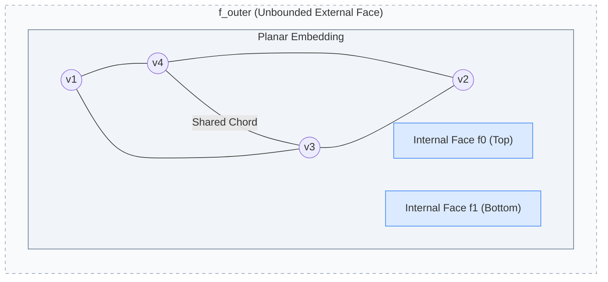

# DCEL Faces and Dual Graph Architecture

This document explains the topological significance of **faces** in a Doubly-Connected Edge List (DCEL), why face identification is critical for orthogonal graph layout algorithms, and how the **Dual Graph** (**G***) is constructed and utilized.

---

## 1. What Are Faces in a DCEL?

A **Doubly-Connected Edge List (DCEL)** is a data structure representing a planar subdivision of the 2D plane. When a planar graph is drawn without edge crossings, its vertices and edges partition the continuous plane into connected 2-dimensional regions called **faces**:



### Types of Faces
1. **Bounded (Internal) Faces (`f0`, `f1`, ...):**
   * Finite polygons completely enclosed by cycles of half-edges.
   * Directed boundary half-edges traverse the cycle in counter-clockwise (CCW) order around the face interior (or clockwise depending on conventions).
2. **Unbounded (External / Outer) Face (`f_outer`):**
   * The single, infinite region that extends outwards around the entire perimeter of the graph.
   * In any planar graph embedded in the 2D plane, there is **exactly one** outer face.
   * Its bounding half-edges circulate around the exterior boundary cycle in the opposite orientation (clockwise on screen).

---

## 2. Why Face Identification Is Critical

In general graph theory, a graph is merely a combinatorial pair **G = (V, E)**. However, in geometric planar drawing—particularly **Orthogonal Layout**—the spaces between the edges (the faces **F**) dictate whether the diagram can be realized without overlaps.

### 2.1 Bend Minimization & Angle Equations (Tamassia's TSM Framework)
The **Topology-Shape-Metrics (TSM)** approach models orthogonal drawing where all edges run on horizontal and vertical grid segments.
* To ensure a face closes into a valid rectilinear polygon on a grid, its interior angles (90°, 180°, 270°, 360°) must satisfy strict geometric sum equations:
  * **Internal Face (`k` vertices):**
    $$\sum \text{internal angles} = (2k - 4) \times 90^\circ$$
    *(e.g., a 4-vertex quadrilateral must sum to (8 - 4) × 90° = 360°)*
  * **Outer Face (`k` boundary vertices):**
    Because the graph lies *inside* the outer boundary cycle, the angle sum condition inverts:
    $$\sum \text{external angles} = (2k + 4) \times 90^\circ$$
* If an algorithm cannot distinguish between internal faces and the outer face, the angle equation constraints fail, and the shape step cannot balance.

### 2.2 Dual Graph Construction (G*)
Minimizing right-angle bends is formulated as a **minimum-cost network flow problem** executed on the **dual graph** (**G***):
* Faces become network nodes.
* Bends are modeled as units of flow crossing boundary edges between neighboring faces.
* The outer face acts as the global sink/reservoir for excess rotation (360° around the external boundary).

### 2.3 Compaction & Metric Realization
During the compaction phase:
* Bounded faces are partitioned into rectangular channels.
* Horizontal and vertical constraint DAGs (directed acyclic graphs) ensure opposite sides of each face maintain matching lengths so polygons remain closed and non-overlapping.
* Without explicit face boundary cycles, coordinate assignment cannot be formulated.

### 2.4 Planar Invariance & Euler Characteristic
For any connected planar graph:
$$V - E + F = 2$$
Tracking faces ensures that graph mutations (edge insertion, vertex subdividing, vertex deletion) preserve planar validity:
* Inserting an edge across an existing face splits 1 face into 2.
* Removing an edge merges 2 adjacent faces into 1.

---

## 3. The Dual Graph (G &rarr; G*)

### 3.1 Terminology & Notation
* **G (Primal Graph):** The original graph consisting of vertices **V** and edges **E** displayed on the canvas.
* **G\* (Dual Graph):** The derived graph where the roles of faces and vertices are inverted. The asterisk (`*`) denotes the dual counterpart.

```
+-----------------------------------+-----------------------------------+
| Primal Graph G                    | Dual Graph G*                     |
+-----------------------------------+-----------------------------------+
| Faces f in F                      | Vertices v* in V*                 |
| Edges e in E                      | Edges e* in E*                    |
| Vertices v in V                   | Faces f* in F*                    |
+-----------------------------------+-----------------------------------+
```

### 3.2 Dual Construction Algorithm
1. **Place a Dual Vertex for Every Face:**
   Inside the interior of each bounded face `fi`, place a dual node `fi*`. In the unbounded exterior face, place a dual node `f_outer*`.
2. **Connect Adjacent Faces Across Shared Edges:**
   For every primal edge `e`, identify the two incident faces `fi` and `fj` separated by `e` (accessed via `halfEdge.incidentFace` and `halfEdge.twin.incidentFace`). Draw a dual edge `e* = (fi*, fj*)` crossing `e` exactly once.

```mermaid
graph TD
    subgraph Primal_Graph_G ["Primal Graph G"]
        v1((v1)) --- v2((v2))
        v2 --- v3((v3))
        v3 --- v1
        v1 --- v4((v4))
        v4 --- v3
    end

    subgraph Dual_Graph_G_Star ["Dual Graph G*"]
        f0["f0* (Left Face)"]
        f1["f1* (Right Face)"]
        f_out["f_outer* (Exterior)"]

        f0 <==>|e*_mid (crosses v1-v3)| f1
        f0 <==>|e*_out1 (crosses v1-v4)| f_out
        f0 <==>|e*_out2 (crosses v4-v3)| f_out
        f1 <==>|e*_out3 (crosses v1-v2)| f_out
        f1 <==>|e*_out4 (crosses v2-v3)| f_out
    end
```

### 3.3 Flow Routing for Bend Minimization
In Tamassia's algorithm:
1. Each dual vertex `f*` has a supply/demand equal to its required angle sum deficiency.
2. Dual edges `e*` carry directed flow representing 90° bends.
3. If `k` units of flow traverse `e* = (fi*, fj*)`, exactly `k` right-angle bends are inserted along primal edge `e`, bending towards face `fj`.

---

## 4. Implementation in `orthogonal`

### 4.1 DCEL Classes
* [`Face.py`](file:///Users/humberto.a.sanchez.ii/PycharmProjects/orthogonal/src/orthogonal/doublyConnectedEdgeList/Face.py): Maintains the incident bounding half-edge cycle (`incidentEdge`, `surroundHalfEdges()`, `surroundVertices()`).
* [`DoublyConnectedEdgeList.py`](file:///Users/humberto.a.sanchez.ii/PycharmProjects/orthogonal/src/orthogonal/doublyConnectedEdgeList/DoublyConnectedEdgeList.py): Populates `faceDict` using planar traversal cycles from NetworkX.
* [`DcelCanvasPanel.py`](file:///Users/humberto.a.sanchez.ii/PycharmProjects/orthogonal/tests/demo/dcelvisualizer/DcelCanvasPanel.py):
  * Calculates signed polygon areas using the **Shoelace Formula**:
    $$A = \frac{1}{2} \sum_{i=0}^{n-1} (x_i y_{i+1} - x_{i+1} y_i)$$
  * Distinguishes the single unbounded outer face from bounded internal faces based on cycle winding orientation.
  * Attaches dynamic tooltip metadata (`_tooltipText`) to face badges, vertices, and half-edges.
* [`DcelShapeCanvas.py`](file:///Users/humberto.a.sanchez.ii/PycharmProjects/orthogonal/tests/demo/dcelvisualizer/DcelShapeCanvas.py): Intercepts `EVT_MOTION` to perform hit-testing with `FindShape(x, y)` and updates tooltips dynamically.

---

## 5. References

* **Grokipedia:** [Doubly connected edge list](https://grokipedia.org/page/Doubly_connected_edge_list)
* **Grokipedia:** [Dual graph](https://grokipedia.org/page/Dual_graph)
* **Grokipedia:** [Planar graph](https://grokipedia.org/page/Planar_graph)
* **Tamassia, Roberto (1987):** *On Embedding a Graph in the Grid with the Minimum Number of Bends*, SIAM Journal on Computing, 16(3), 421–444.
