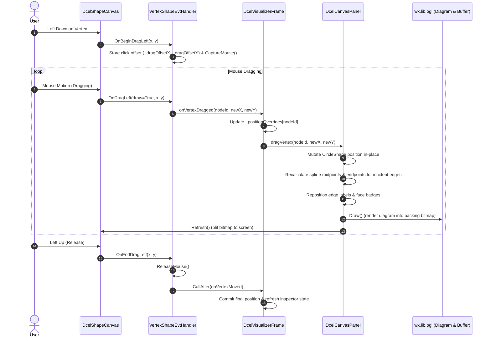

# DCEL Visualizer Real-Time Node Dragging Architecture

This document explains the mechanism that enables interactive, real-time node dragging in the wxPython DCEL Visualizer demo application ([`DcelVisualizer.py`](file:///Users/humberto.a.sanchez.ii/PycharmProjects/orthogonal/tests/demo/dcelvisualizer/DcelVisualizer.py)).

---

## 1. Background & Problem Statement

In standard `wx.lib.ogl` (Object Graphics Library):

1. **No Live Coordinate Movement:**
   In [`wx.lib.ogl.basic.Shape.OnDragLeft`](file:///Users/humberto.a.sanchez.ii/PycharmProjects/orthogonal/pyenv-3.13.12/lib/python3.13/site-packages/wx/lib/ogl/basic.py), OGL does not modify the shape's logical coordinates (`_xpos` or `_ypos`) during dragging. Instead, it attempts to draw a temporary dotted rectangular outline directly to the screen using a raw `wx.ClientDC` with XOR color inversion (`wx.INVERT`). On modern macOS (Quartz/Cocoa compositor), drawing to `wx.ClientDC` outside of an `EVT_PAINT` handler is deprecated and ignored.
2. **Missing Window Invalidation:**
   [`wx.lib.ogl.canvas.ShapeCanvas.OnMouseEvent`](file:///Users/humberto.a.sanchez.ii/PycharmProjects/orthogonal/pyenv-3.13.12/lib/python3.13/site-packages/wx/lib/ogl/canvas.py) calls `self.Draw()` to re-render shapes to an offscreen bitmap buffer (`_buffer`), but never calls `self.Refresh()`. Consequently, the macOS window never repaints during mouse motion.
3. **Delayed Coordinate Commit ("Snapping"):**
   The shape's position was updated only when the mouse button was released in [`Shape.OnEndDragLeft`](file:///Users/humberto.a.sanchez.ii/PycharmProjects/orthogonal/pyenv-3.13.12/lib/python3.13/site-packages/wx/lib/ogl/basic.py). This caused dragged nodes to remain frozen in their original positions and suddenly snap to the release position.

---

## 2. Event & Data Flow

To provide instant feedback, the application intercepts dragging events at the shape level, routes live coordinates through the top-level frame, mutates canvas shapes in-place, and forces buffer flushes:



---

## 3. Component Implementation Details

### 3.1. Tracking Drag Offsets & Mouse Capture: [`VertexShapeEvtHandler`](file:///Users/humberto.a.sanchez.ii/PycharmProjects/orthogonal/tests/demo/dcelvisualizer/VertexShapeEvtHandler.py)

The [`VertexShapeEvtHandler`](file:///Users/humberto.a.sanchez.ii/PycharmProjects/orthogonal/tests/demo/dcelvisualizer/VertexShapeEvtHandler.py#L14-L78) class extends `wx.lib.ogl.ShapeEvtHandler`:

- **Offset Calculation (`OnBeginDragLeft`):**
  Calculates the vector from the mouse click position to the center of the shape:
  ```python
  self._dragOffsetX = float(shape.GetX()) - float(x)
  self._dragOffsetY = float(shape.GetY()) - float(y)
  ```
  This prevents the shape from popping its center directly under the cursor upon the first drag step.
- **Mouse Capture (`CaptureMouse`):**
  Ensures that dragging remains active even if the user moves the mouse rapidly beyond the canvas window boundaries.
- **Live Dispatch (`OnDragLeft`):**
  OGL invokes `OnDragLeft` twice per mouse event (once with `draw=False` to erase, and once with `draw=True` to draw). The handler filters for `draw=True`, computes `(newX, newY)`, and invokes [`DcelVisualizerFrame.onVertexDragged`](file:///Users/humberto.a.sanchez.ii/PycharmProjects/orthogonal/tests/demo/dcelvisualizer/DcelVisualizerFrame.py#L487-L497).
- **Clean Drop (`OnEndDragLeft`):**
  Releases mouse capture and schedules [`DcelVisualizerFrame.onVertexMoved`](file:///Users/humberto.a.sanchez.ii/PycharmProjects/orthogonal/tests/demo/dcelvisualizer/DcelVisualizerFrame.py#L499-L508) via `wx.CallAfter` to finalize positions and update inspector tables.

---

### 3.2. In-Place Geometric Recalculation: [`DcelCanvasPanel.dragVertex`](file:///Users/humberto.a.sanchez.ii/PycharmProjects/orthogonal/tests/demo/dcelvisualizer/DcelCanvasPanel.py)

Rebuilding the DCEL or calling `DeleteAllShapes()` mid-drag would destroy the `CircleShape` that `ShapeCanvas.OnMouseEvent` is actively tracking, causing access violations or unhandled exceptions.

Instead, [`DcelCanvasPanel`](file:///Users/humberto.a.sanchez.ii/PycharmProjects/orthogonal/tests/demo/dcelvisualizer/DcelCanvasPanel.py#L56-L265) retains direct references to:
- `self._shapeMap`: Maps `NodeId` to the vertex's [`CircleShape`](file:///Users/humberto.a.sanchez.ii/PycharmProjects/orthogonal/tests/demo/dcelvisualizer/DcelCanvasPanel.py#L101-L121).
- `self._edgeShapes`: List of `(uId, vId, line, edgeLabel)`.
- `self._faceShapes`: List of `(cycleNodes, offsetY, faceBadge)`.

When [`dragVertex(nodeId, newX, newY)`](file:///Users/humberto.a.sanchez.ii/PycharmProjects/orthogonal/tests/demo/dcelvisualizer/DcelCanvasPanel.py#L210-L265) is called:

1. **Vertex Relocation:**
   ```python
   self._positions[nodeId] = (newX, newY)
   if nodeId in self._shapeMap:
       circle: CircleShape = self._shapeMap[nodeId]
       circle.SetX(newX)
       circle.SetY(newY)
   ```
2. **Directed Half-Edge Arcs & Label Badges:**
   For every edge where `uId == nodeId` or `vId == nodeId`:
   - Computes the perpendicular normal vector:
     $$\mathbf{d} = (x_v - x_u, y_v - y_u), \quad \hat{\mathbf{n}} = \left(-\frac{d_y}{\|\mathbf{d}\|}, \frac{d_x}{\|\mathbf{d}\|}\right)$$
   - Computes the spline control point midpoint:
     $$\mathbf{m} = \frac{\mathbf{p}_u + \mathbf{p}_v}{2} + \hat{\mathbf{n}} \cdot \text{OFFSET}$$
   - Updates the line's spline bend control point (`ctrlPoints[1]`):
     ```python
     ctrlPoints = line.GetLineControlPoints()
     ctrlPoints[1].x = midX
     ctrlPoints[1].y = midY
     ```
   - Invokes `line.FindLineEndPoints()` and `line.SetEnds(...)` to recalculate the exact perimeter contact points on both circles (`ctrlPoints[0]` and `ctrlPoints[2]`).
   - Repositions the `u->v` rectangular badge at `(midX, midY)`.
3. **Face Centroid Badges:**
   For every face containing `nodeId` in its boundary cycle, recalculates the polygon centroid:
   $$C_x = \frac{1}{k}\sum_{i=1}^k x_i, \quad C_y = \frac{1}{k}\sum_{i=1}^k y_i$$
   and repositions the face badge at $(C_x, C_y + \text{offset}_y)$.
4. **Immediate Repaint:**
   Calls `self._canvas.Draw()` to re-render the diagram into the backing `wx.Bitmap` memory DC, followed by `self._canvas.Refresh()` to blit the updated bitmap onto the screen.

---

### 3.3. State Persistence: [`DcelVisualizerFrame`](file:///Users/humberto.a.sanchez.ii/PycharmProjects/orthogonal/tests/demo/dcelvisualizer/DcelVisualizerFrame.py)

- **Live Drag Updates:**
  [`onVertexDragged(nodeId, newX, newY)`](file:///Users/humberto.a.sanchez.ii/PycharmProjects/orthogonal/tests/demo/dcelvisualizer/DcelVisualizerFrame.py#L487-L497) updates `self._positionOverrides[nodeId]` so the application's single source of truth remains consistent throughout the drag.
- **Finalized Step Persistence:**
  [`onVertexMoved(nodeId, newX, newY)`](file:///Users/humberto.a.sanchez.ii/PycharmProjects/orthogonal/tests/demo/dcelvisualizer/DcelVisualizerFrame.py#L499-L508) stores the coordinate and triggers `self._refreshState()`, ensuring that any replayed steps or toolbar scrub actions retain the user's manual adjustments.
